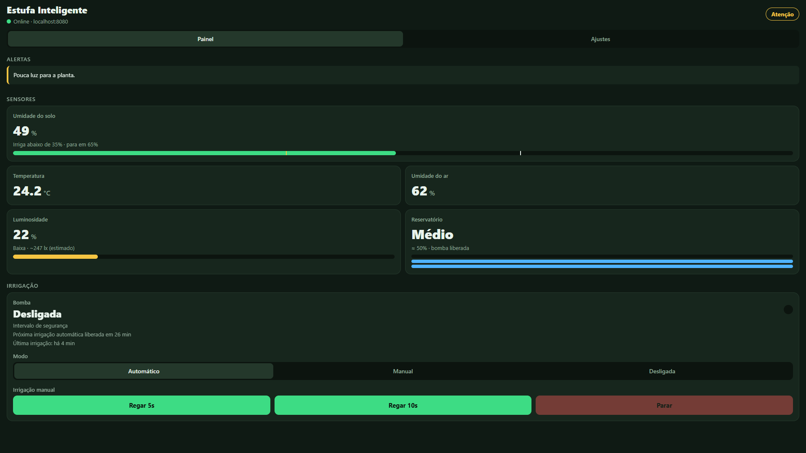

# Estufa Inteligente com ESP32

Estufa automatizada que monitora solo, ar, luz e reservatório, irriga sozinha com proteções para a bomba e se comunica com um app de celular pelo Wi-Fi.



## Componentes confirmados

| Função | Modelo |
|---|---|
| Microcontrolador | ESP32 DevKit V1 (WROOM-32) |
| Temperatura e umidade do ar | DHT11 |
| Luminosidade | LDR (GL5528) + resistor 10 kΩ |
| Umidade do solo | Sensor resistivo + módulo LM393 |
| Nível do reservatório | Eletrodos (1 comum + 3 níveis) |
| Display | LCD gráfico 128x64 backlight azul (ST7920) |
| Irrigação | Bomba DC 5 V acionada por MOSFET IRLZ44N |

## Estrutura do repositório

```
firmware/estufa_esp32/   código do ESP32 (Arduino IDE)
app/                     app Expo / React Native (Android, iOS e web)
tools/mock-esp32/        simulador do ESP32 para desenvolver o app sem hardware
docs/                    documentação completa do projeto
```

## Documentação (as 12 etapas)

| Etapa | Onde |
|---|---|
| 1 a 5: arquitetura, materiais, componentes, pinos, esquema elétrico e cuidados | [docs/01-hardware.md](docs/01-hardware.md) |
| 6 a 8: bibliotecas, organização do código e lógica de funcionamento | [docs/02-firmware.md](docs/02-firmware.md) |
| 9 a 11: montagem e testes, calibração, problemas e soluções | [docs/03-montagem-testes.md](docs/03-montagem-testes.md) |
| Contrato da API (firmware ↔ app) | [docs/api.md](docs/api.md) |
| 12: melhorias futuras | abaixo |

## Início rápido

### Quem está montando o hardware
1. Siga [docs/01-hardware.md](docs/01-hardware.md) para a ligação.
2. Instale a IDE e as bibliotecas conforme [docs/02-firmware.md](docs/02-firmware.md#6-instalação-da-arduino-ide-e-das-bibliotecas).
3. Copie `firmware/estufa_esp32/secrets.example.h` para `secrets.h` e coloque o Wi-Fi (rede de **2,4 GHz**).
4. Grave, abra o Monitor Serial (115200) e anote o IP. Teste componente por componente com [docs/03-montagem-testes.md](docs/03-montagem-testes.md).

### Quem está desenvolvendo o app
```bash
# 1) Simulador do ESP32 (outro terminal)
cd tools/mock-esp32
npm install
npm start            # mostra o endereço, ex.: 192.168.0.10:8080

# 2) App
cd app
npm install
npx expo start       # abra no Expo Go (celular na mesma rede) ou aperte "w" para o navegador
```
Na tela de conexão, digite o endereço que o simulador mostrou. Quando o ESP32 real estiver pronto, toque em **Ajustes → Trocar ESP32** e digite o IP dele: o app é o mesmo, porque o simulador segue o mesmo contrato da API.

**Builds de produção:** o ESP32 fala HTTP sem criptografia (normal em rede local). O `app.json` já libera isso no Android (`usesCleartextTraffic`) e no iOS (`NSAllowsLocalNetworking`).

## Como o app se conecta

- **No roteador:** ESP32 e celular na mesma rede; use o IP mostrado no LCD. Dica: reserve um IP fixo para o ESP32 no roteador.
- **Sem roteador (ex.: numa feira):** se o ESP32 não achar a rede em 20 s, ele cria a rede `Estufa-ESP32` (senha `estufa123`). Conecte o celular nela e use `192.168.4.1`.
- Dados em tempo real via WebSocket, com reconexão automática e consulta HTTP como reserva.

## 12. Sugestões de melhorias futuras

**Sensores melhores**
- Trocar o sensor de solo resistivo por um **capacitivo** (não corrói).
- Trocar o DHT11 por **DHT22, SHT31 ou BME280** (mais precisos; os pinos I2C 21 e 22 estão livres).
- Usar um **BH1750** (I2C) para medir lux de verdade.
- Medir o reservatório com um sensor ultrassônico à prova d'água (JSN-SR04T) para ter porcentagem contínua.

**Firmware**
- Relógio via NTP para **não irrigar à noite** e registrar horários.
- Atualização do firmware pelo Wi-Fi (**OTA**), sem cabo USB.
- Configurar o Wi-Fi pelo celular (WiFiManager), sem recompilar.
- Histórico de leituras na flash ou em cartão SD.
- Senha ou token na API.

**Atuadores**
- Ventoinha (temperatura alta) e fita de LED de cultivo (pouca luz), cada uma com o seu MOSFET.
- Buzzer de alerta e controle do backlight do LCD.
- Várias zonas ou vasos com válvulas solenoides.

**App e nuvem**
- Gráficos de histórico.
- Acesso fora de casa via MQTT (HiveMQ, Adafruit IO) ou Firebase, e notificações push de "reservatório baixo".
- Perfis de planta prontos (suculenta, horta, ervas) que preenchem os limites automaticamente.

**Montagem**
- Placa de circuito impresso (PCB) no lugar da protoboard.
- Caixa com vedação IP65 e prensa-cabos.
- Alimentação solar com bateria.
