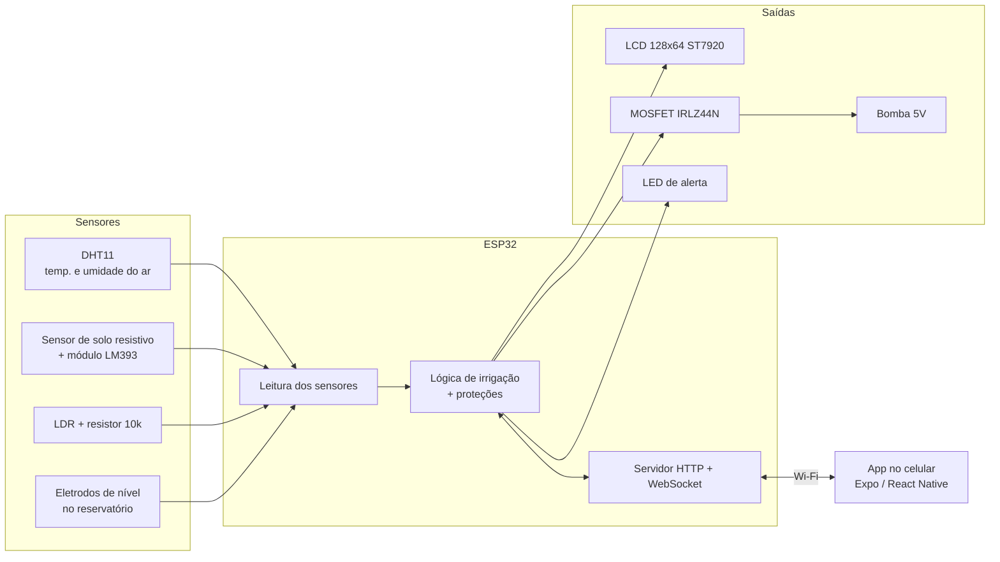

# Parte 1: Hardware (etapas 1 a 5)

## 1. Arquitetura do sistema



O ESP32 trabalha sozinho: lê os sensores, decide irrigar e mostra tudo no LCD. O app é **opcional para o funcionamento**: ele só acompanha os dados e muda configurações. Se o Wi-Fi cair, a estufa continua irrigando normalmente.

## 2. Lista de materiais

| Qtd | Componente | Observação |
|---|---|---|
| 1 | ESP32 DevKit V1 (ESP-WROOM-32), 30 ou 38 pinos | Escolha "ESP32 Dev Module" na Arduino IDE |
| 1 | DHT11 | Módulo de 3 pinos já vem com resistor; o de 4 pinos precisa de 1 resistor de 10 kΩ |
| 1 | Sensor de umidade do solo **resistivo** + módulo LM393 (YL-69 / FC-28) | Usaremos a saída analógica **AO** |
| 1 | LDR 5 mm (GL5528) | + 1 resistor de 10 kΩ |
| 4 | Eletrodos de aço inox (parafusos, hastes ou fios) | 1 comum + 3 de nível |
| 3 | Resistor 100 kΩ | Pull-down dos eletrodos de nível |
| 1 | Resistor 1 kΩ | Em série com o eletrodo comum (limita corrente) |
| 1 | Bomba submersível 5 V DC | Mangueira de silicone compatível com o bico |
| 1 | MOSFET canal N **logic-level** IRLZ44N | Alternativas: IRLB8721, AO3400. **Não use IRF520** (precisa de 10 V no gate) |
| 1 | Diodo 1N5819 (ou 1N4007) | Diodo de roda-livre da bomba |
| 1 | Resistor 220 Ω | Gate do MOSFET |
| 1 | Resistor 10 kΩ | Gate → GND (bomba desligada no boot) |
| 1 | LCD gráfico 128x64 com backlight azul (controlador **ST7920**, 5 V) | Usado em modo serial (3 fios) |
| 1 | Conversor de nível lógico 3,3 V ↔ 5 V, 4 canais (BSS138) | Para os sinais do LCD (recomendado) |
| 1 | LED vermelho 5 mm + resistor 220 Ω | Alerta visual |
| 1 | Fonte 5 V **2 A** (ou mais) | Fonte chaveada ou carregador USB de boa qualidade |
| 1 | Capacitor eletrolítico 1000 µF / 10 V ou mais | Na entrada de 5 V, perto da bomba |
| 1 | Capacitor cerâmico 100 nF | Perto do pino VIN do ESP32 |
| - | Protoboard ou placa perfurada, jumpers, bornes, reservatório, fios | |

> **Confirme na montagem:** se o "sensor de nível com eletrodos" que vocês compraram for um módulo pronto com circuito próprio (por exemplo, com transistor ou CI e saída digital), me avise o modelo: a ligação e o código mudam. Este projeto considera hastes/eletrodos simples ligados diretamente ao ESP32.

## 3. Como cada componente funciona

**ESP32.** É um microcontrolador de 3,3 V com Wi-Fi. Os pinos aceitam **no máximo 3,3 V**: 5 V em um GPIO pode queimar o chip. Ele tem dois conversores analógico-digitais (ADC); o **ADC2 para de funcionar quando o Wi-Fi está ligado**, então todas as leituras analógicas usam os pinos do ADC1 (GPIO 32 a 39).

**DHT11.** É um sensor digital com protocolo próprio de um fio. Mede de 0 a 50 °C (±2 °C) e de 20 a 90 % de umidade (±5 %). Só pode ser lido **uma vez por segundo**; o código lê a cada 2,5 s. A leitura falha de vez em quando, e por isso o firmware só marca erro depois de 3 falhas seguidas.

**Sensor de solo resistivo.** O garfo mede a resistência da terra: terra molhada conduz mais, e a tensão na saída AO **cai**. Problema conhecido: com corrente contínua passando o tempo todo, as trilhas sofrem **eletrólise** e corroem em semanas. Solução usada aqui: o módulo é alimentado por um GPIO (25) e só fica ligado por cerca de 20 ms a cada leitura.

**LDR.** É um resistor que diminui de valor com a luz. Em um divisor de tensão com um resistor de 10 kΩ, mais luz significa **mais tensão** no pino. O LDR **não é um luxímetro**: o valor em lux exibido é uma **estimativa** (curva típica do GL5528), boa para comparar ambientes, não para medir com precisão. A medida principal é a porcentagem calibrada.

**Sensor de nível por eletrodos.** A água da torneira conduz eletricidade. Um eletrodo comum fica no fundo; outros 3 ficam em alturas diferentes. Quando a água toca um eletrodo, a corrente vai do comum até ele pela água, e a tensão no pino sobe. Assim o sistema sabe se o nível está acima de 20 %, 50 % ou 90 %. O comum também só é energizado durante a leitura, contra a corrosão.

**Bomba 5 V + MOSFET.** O ESP32 fornece só cerca de 20 mA por pino, e a bomba consome de 100 a 300 mA (mais na partida). O MOSFET funciona como uma chave eletrônica: o GPIO controla o gate e a corrente da bomba passa pelo dreno e pela fonte, vinda direto da fonte de 5 V. O **diodo** absorve o pico de tensão gerado pelo motor ao desligar, que poderia queimar o MOSFET.

**LCD 128x64 ST7920.** É um display gráfico de 5 V. Com o pino **PSB ligado ao GND**, ele entra em modo serial e precisa só de 3 fios de dados (E, R/W e RS). A biblioteca U8g2 desenha textos e formas.

## 4. Mapeamento dos pinos do ESP32

| GPIO | Ligado a | Tipo | Motivo da escolha |
|---|---|---|---|
| 4 | DHT11 DATA | Digital | Pino comum, sem função de boot |
| 36 (VP) | Solo: saída AO do LM393 | Analógico (ADC1) | Só entrada; ADC1 funciona com Wi-Fi |
| 25 | Solo: VCC do módulo | Saída | Liga o sensor só durante a leitura |
| 39 (VN) | LDR (ponto médio do divisor) | Analógico (ADC1) | Só entrada |
| 26 | Eletrodo comum (via 1 kΩ) | Saída | Energiza só durante a leitura |
| 34 | Eletrodo de nível 1 (20 %) | Analógico (ADC1) | Só entrada, sem pull interno → 100 kΩ externo |
| 35 | Eletrodo de nível 2 (50 %) | Analógico (ADC1) | Idem |
| 32 | Eletrodo de nível 3 (90 %) | Analógico (ADC1) | Idem |
| 27 | Gate do MOSFET da bomba (via 220 Ω) | Saída | Não oscila no boot |
| 18 | LCD **E** (SCLK) | SPI | Clock do SPI de hardware |
| 23 | LCD **R/W** (SID) | SPI | Dados do SPI de hardware |
| 13 | LCD **RS** (CS) | Saída | Seleção do display |
| 14 | LED vermelho de alerta (via 220 Ω) | Saída | Pisca rápido em alerta |
| 2 | LED azul da placa | Saída | Estado do Wi-Fi |
| 33 | **Livre** (ADC1) | - | Reserva para expansão |
| 21, 22 | **Livres** (I2C) | - | Reserva para sensores I2C futuros |

**Pinos evitados:** 0, 2, 5, 12 e 15 são *strapping pins* (definem o modo de boot; o GPIO 12 em nível alto no boot impede o ESP32 de iniciar). Os pinos 6 a 11 são ligados à memória flash e **nunca** devem ser usados. Os pinos 1 e 3 são a porta serial USB.

Todos os pinos estão em `firmware/estufa_esp32/config.h`. Se mudar a montagem, mude lá.

## 5. Esquema de ligação elétrica

### 5.1 Alimentação

```
 FONTE 5V 2A (+) ──┬───────────────┬──────────────┬─────────────┬──────────────┐
                   │               │              │             │              │
              [1000µF]+       ESP32 VIN       LCD VDD (2)   LCD BLA (19)   Bomba (+)
                   │          [100nF]─GND     LCD RST (17)  Conversor HV
                   │                                                           │
 FONTE 5V 2A (-) ──┴──────── GND COMUM (ESP32 GND, LCD, sensores, MOSFET S) ───┘

 ESP32 3V3 ──> DHT11 VCC, LDR, conversor de nível LV
```

- **Um único GND comum** para tudo. Sem GND comum, os sinais não têm referência e nada funciona.
- Os sensores são alimentados em **3,3 V** (pino 3V3 ou GPIO), então suas saídas nunca passam de 3,3 V. Isso protege os pinos do ESP32.
- Só o LCD, o lado HV do conversor e a bomba usam 5 V.
- **Nunca** alimente a bomba pelos pinos 3V3 ou 5V da placa do ESP32.
- **Ao gravar pelo USB**, desligue o fio da fonte que vai ao VIN (muitas placas não têm diodo separando o USB do VIN). O GND pode continuar ligado.

### 5.2 Sensores

```
DHT11 (módulo 3 pinos)          DHT11 (4 pinos, sem módulo)
  VCC  ── 3V3                     1 VCC  ── 3V3 ──[10kΩ]──┐
  DATA ── GPIO 4                  2 DATA ── GPIO 4 ───────┘
  GND  ── GND                     3 NC
                                  4 GND  ── GND

SOLO (módulo LM393)              LDR (divisor de tensão)
  VCC ── GPIO 25                  3V3 ──[LDR]──┬──[10kΩ]── GND
  GND ── GND                                   │
  AO  ── GPIO 36 (VP)                       GPIO 39 (VN)
  DO  ── (não ligar)
  garfo ── pinos +/- do módulo
```

### 5.3 Eletrodos de nível

```
                                 RESERVATÓRIO (vista lateral)
GPIO 26 ──[1kΩ]── COMUM ─────┐   ┌───────────────────┐
                             │   │  E3 (90%) ──────────── GPIO 32 ──[100kΩ]── GND
                             │   │                   │
                             │   │  E2 (50%) ──────────── GPIO 35 ──[100kΩ]── GND
                             │   │                   │
                             │   │  E1 (20%) ──────────── GPIO 34 ──[100kΩ]── GND
                             │   │  ~~~~~~ bomba ~~~ │
                             └──── COMUM (no fundo)  │
                                 └───────────────────┘
```

- O eletrodo **comum** vai até o fundo. Os outros ficam com a ponta na altura do nível que representam.
- **O E1 tem que ficar ACIMA da entrada de água da bomba.** Por padrão, a bomba só liga com o E1 molhado (`reservoirMinElec = 1`); se o E1 estiver abaixo da entrada, a bomba pode trabalhar a seco.
- Afaste os eletrodos 1 a 2 cm entre si e use aço inox (cobre e ferro oxidam rápido).
- Água destilada ou de chuva conduz pouco. Se usar uma delas, reduza `electrodeThreshMv` no app (veja a calibração).

### 5.4 Bomba com MOSFET

```
          +5V
           │
     ┌─────┴─────┐
     │           │
  (Bomba)     ▲ 1N5819  (faixa do diodo/catodo virada para o +5V)
     │           │
     └─────┬─────┘
           │
           D  IRLZ44N  (de frente, pernas para baixo: G  D  S)
GPIO 27 ──[220Ω]── G
           │       │
         [10kΩ]    S
           │       │
          GND     GND
```

- O resistor de 10 kΩ entre o gate e o GND garante a bomba **desligada** enquanto o ESP32 está iniciando ou reiniciando.
- Se usar um **módulo relé** no lugar do MOSFET, ligue VCC em 5 V, GND e IN no GPIO 27, e mude `PUMP_ACTIVE_HIGH` para `false` em `config.h` (a maioria aciona com nível baixo). Atenção: alguns módulos relé de 5 V não desligam direito com sinal de 3,3 V. O MOSFET é a opção mais confiável.

### 5.5 LCD ST7920 (modo serial)

| Pino LCD | Nome | Liga em |
|---|---|---|
| 1 | VSS | GND |
| 2 | VDD | 5 V |
| 3 | V0 | Não ligar se o módulo tiver trimpot de contraste. Se não tiver, use o cursor de um potenciômetro de 10 kΩ |
| 4 | RS (CS) | Conversor HV1 ← LV1 ← **GPIO 13** |
| 5 | R/W (SID) | Conversor HV2 ← LV2 ← **GPIO 23** |
| 6 | E (SCLK) | Conversor HV3 ← LV3 ← **GPIO 18** |
| 7 a 14 | DB0 a DB7 | Não ligar |
| 15 | **PSB** | **GND** (ativa o modo serial) |
| 16 | NC | Não ligar |
| 17 | RST | 5 V |
| 18 | VOUT | Não ligar |
| 19 | BLA (backlight +) | 5 V (confira se o módulo tem resistor; quase todos têm) |
| 20 | BLK (backlight −) | GND |

Conversor de nível: **LV** no 3V3, **HV** no 5 V e **GND** nos dois lados.

> Sem conversor, muitos ST7920 funcionam com 3,3 V, mas isso fica fora da especificação (o chip espera pelo menos 3,5 V como nível alto). Se a tela ficar em branco ou com lixo, o conversor resolve. Como o LCD só **recebe** dados, ele nunca devolve 5 V ao ESP32.

### 5.6 LED de alerta

```
GPIO 14 ──[220Ω]──|>|── GND     (perna longa do LED = anodo, voltada para o resistor)
```

## Cuidados para não danificar o ESP32

1. **Nunca coloque 5 V em um GPIO.** Os sensores ficam em 3,3 V justamente para isso.
2. **Monte e altere a fiação sempre com tudo desligado** (USB e fonte).
3. Confira a polaridade da fonte antes de ligar. Inverter o +5 V e o GND queima o regulador da placa.
4. Não use o ADC2 (GPIO 0, 2, 4, 12 a 15, 25 a 27) para leitura analógica: ele não funciona com Wi-Fi ligado.
5. Não puxe mais de 20 mA de um GPIO. Cargas maiores sempre passam por transistor, MOSFET ou relé.
6. Use o diodo na bomba e os capacitores na alimentação. Picos do motor podem reiniciar o ESP32 (o famoso *brownout*).
7. Mantenha a eletrônica **longe da água**: o reservatório fica abaixo da placa e os fios descem até ele. Use uma caixa e prenda as mangueiras.
8. Não ligue USB e fonte no VIN ao mesmo tempo sem saber se a placa tem diodo de proteção.
