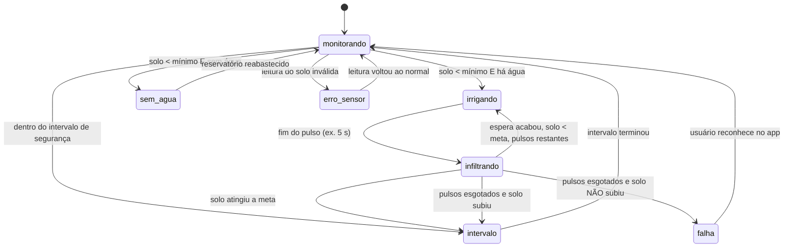

# Parte 2: Firmware (etapas 6 a 8)

## 6. Instalação da Arduino IDE e das bibliotecas

1. Instale a [Arduino IDE 2](https://www.arduino.cc/en/software).
2. Em **Arquivo → Preferências → URLs adicionais**, adicione:
   `https://espressif.github.io/arduino-esp32/package_esp32_index.json`
3. Em **Ferramentas → Placa → Gerenciador de placas**, instale **esp32 by Espressif Systems** (versão 3.x; o projeto foi compilado com a 3.3.12).
4. Em **Ferramentas → Gerenciar bibliotecas**, instale:

| Biblioteca | Autor | Para quê |
|---|---|---|
| U8g2 | oliver | LCD ST7920 |
| DHT sensor library | Adafruit | DHT11 (aceite instalar a dependência *Adafruit Unified Sensor*) |
| ArduinoJson (7.x) | Benoit Blanchon | Montar e ler JSON da API |
| ESP Async WebServer | **ESP32Async** | Servidor HTTP + WebSocket |
| Async TCP | **ESP32Async** | Base do servidor assíncrono |

> Existem cópias antigas do "AsyncWebServer" (me-no-dev e outros) que não compilam no core 3.x. Instale as publicadas por **ESP32Async**.

5. Configure a placa: **Ferramentas → Placa → ESP32 Dev Module**, Partition Scheme *Default 4MB with spiffs*.
6. Wi-Fi: copie `firmware/estufa_esp32/secrets.example.h` para `secrets.h` na mesma pasta e preencha o nome e a senha da rede. Esse arquivo não vai para o Git.
7. Abra `firmware/estufa_esp32/estufa_esp32.ino`. As outras abas abrem junto. Compile e grave.

**Resultado da compilação de referência:** 1.076.559 bytes de flash (82 %) e 51.632 bytes de RAM (15 %). Se futuras expansões passarem de 100 % da flash, troque o Partition Scheme para *Huge APP*.

## 7. Organização do código

```
firmware/estufa_esp32/
├── estufa_esp32.ino   setup(), loop(), comandos, LEDs, Monitor Serial
├── config.h           PINOS, intervalos, proteções, valores de fábrica  ← comece aqui
├── secrets.h          nome/senha do Wi-Fi (você cria)
├── types.h            structs compartilhadas (leituras, estados, Settings)
├── sensors.h/.cpp     leitura de DHT11, solo, LDR e eletrodos
├── irrigation.h/.cpp  máquina de estados da bomba e proteções
├── status.h/.cpp      alertas e estado geral (ok / atenção / alerta)
├── display.h/.cpp     telas do LCD
├── api_server.h/.cpp  Wi-Fi, API REST, WebSocket, mDNS
└── settings.h/.cpp    configurações salvas na flash (NVS)
```

Cada módulo tem uma responsabilidade só. Para trocar o DHT11 por um DHT22, por exemplo, basta mudar o `sensors.cpp`; o resto do código não percebe a diferença.

## 8. Lógica de funcionamento

### 8.1 O loop sem `delay()`

```
loop() roda milhares de vezes por segundo:
  1. executa comandos que chegaram do app (fila)
  2. sensorsUpdate()    → cada sensor confere se "já deu o tempo dele"
  3. irrigationUpdate() → decide ligar/desligar a bomba
  4. computeAlerts()    → calcula alertas e estado geral
  5. rede               → mantém Wi-Fi e envia dados ao app
  6. LCD / LEDs / log   → também por intervalo
```

Cada tarefa guarda o `millis()` da última execução e só roda de novo quando o intervalo passa:

| Tarefa | Intervalo |
|---|---|
| DHT11 | 2,5 s |
| Solo, LDR | 1 s |
| Eletrodos de nível | 2 s (0,5 s com a bomba ligada) |
| LCD | 1 s (troca de tela a cada 5 s) |
| Envio ao app (WebSocket) | 2 s, ou na hora quando a bomba muda de estado |
| Log no Monitor Serial | 5 s |

Sensores que precisam ser energizados antes da leitura (solo e eletrodos) usam duas fases sem `delay()`: em uma volta do loop liga a alimentação; numa volta seguinte, depois de 20 ms (solo) ou 5 ms (eletrodos), lê e desliga.

A única espera inevitável é a do DHT11 (cerca de 25 ms por leitura, imposta pelo protocolo do sensor).

### 8.2 Leituras analógicas confiáveis

- `analogReadMilliVolts()` já corrige a curva não linear do ADC do ESP32 com a calibração de fábrica do chip.
- O firmware faz **16 amostras**, ordena, descarta os extremos e tira a média do meio.
- Se a diferença entre as amostras for muito grande (fio solto: o pino "flutua"), a leitura é marcada como **inválida**.
- No solo, tensão quase zero também é inválida: indica módulo sem alimentação ou em curto.
- No nível, "eletrodo de cima molhado e o de baixo seco" é fisicamente impossível, então também vira leitura inválida.
- O nível só muda depois de 2 leituras iguais seguidas, porque a água balança com a bomba ligada.

### 8.3 Máquina de estados da irrigação



**Por que em pulsos?** A água leva tempo para descer até o sensor. Se a bomba ficasse ligada até o sensor marcar 60 %, o vaso encharcaria antes da leitura subir. Então a irrigação funciona assim: liga por `pulseS`, espera `soakS` para a água infiltrar, mede e repete se precisar, até no máximo `maxPulses` pulsos por ciclo.

**Histerese.** A irrigação começa abaixo de `soilMinPct` (35 %) e só para em `soilTargetPct` (60 %). Com um limite único, a bomba ficaria ligando e desligando em torno dele.

### 8.4 Proteções da bomba (em camadas)

| Proteção | Onde | Configurável? |
|---|---|---|
| Não liga sem água: precisa de `reservoirMinElec` eletrodos molhados | `irrigation.cpp` | Sim (app) |
| Desliga na hora se o nível cair durante a irrigação | `irrigation.cpp` | Não |
| Intervalo de segurança entre ciclos (`cooldownMin`), inclusive após irrigação manual | `irrigation.cpp` | Sim |
| Máximo de pulsos por ciclo | `irrigation.cpp` | Sim |
| Detecção de falha: bombeou tudo e o solo não subiu 3 % → trava até o usuário reconhecer | `irrigation.cpp` | Não |
| Não irriga com o sensor de solo com defeito | `irrigation.cpp` | Não |
| Limite absoluto: nunca mais de 60 s seguidos ligada | `config.h` | Só no código |
| O app aceita no máximo 45 s por pulso ou acionamento manual | `config.h` | Só no código |
| Watchdog: se o loop travar por 10 s, o ESP32 reinicia | `.ino` | Só no código |
| Resistor de 10 kΩ no gate: bomba desligada no boot e no reset | Hardware | - |
| Bomba é desligada **antes** de qualquer outra inicialização | `setup()` | - |

### 8.5 Estado geral e alertas

- **alerta** (LED vermelho piscando, cabeçalho do LCD piscando no caso da água): reservatório baixo ou vazio, falha na irrigação, sensor de solo ou de nível com defeito.
- **atenção**: temperatura, umidade do ar ou luz fora da faixa ideal, solo seco, DHT11 ou LDR com erro.
- **ok**: nada fora do normal.

As faixas ideais são configuráveis pelo app.

### 8.6 Comunicação com o app

- O ESP32 tenta o roteador por 20 s. Se não conseguir, cria a própria rede **"Estufa-ESP32"** (senha `estufa123`, IP `192.168.4.1`) e continua tentando o roteador em paralelo.
- Com o roteador, o IP aparece no LCD (2ª tela) e no Monitor Serial. O ESP32 também responde como `http://estufa.local`.
- API REST para comandos e WebSocket (`/ws`) para dados em tempo real. Contrato completo em [api.md](api.md).
- **Concorrência:** o servidor web roda em outra tarefa do FreeRTOS. Ele nunca mexe direto no estado: lê uma "foto" JSON protegida por *mutex* e envia comandos por uma **fila**, que o `loop()` executa. Assim nunca há duas tarefas alterando a mesma variável ao mesmo tempo.
- As configurações são gravadas na flash (NVS) e sobrevivem a quedas de energia.

### 8.7 Comandos pelo Monitor Serial (115200 baud)

| Tecla | Ação |
|---|---|
| `p` | Mostra todas as leituras (inclusive os mV brutos para calibrar) |
| `b` | Liga a bomba por 3 s (respeita o nível do reservatório) |
| `s` | Para a bomba |
| `a` / `m` / `o` | Modo automático / manual / desligado |
| `f` | Reconhece uma falha de irrigação |
